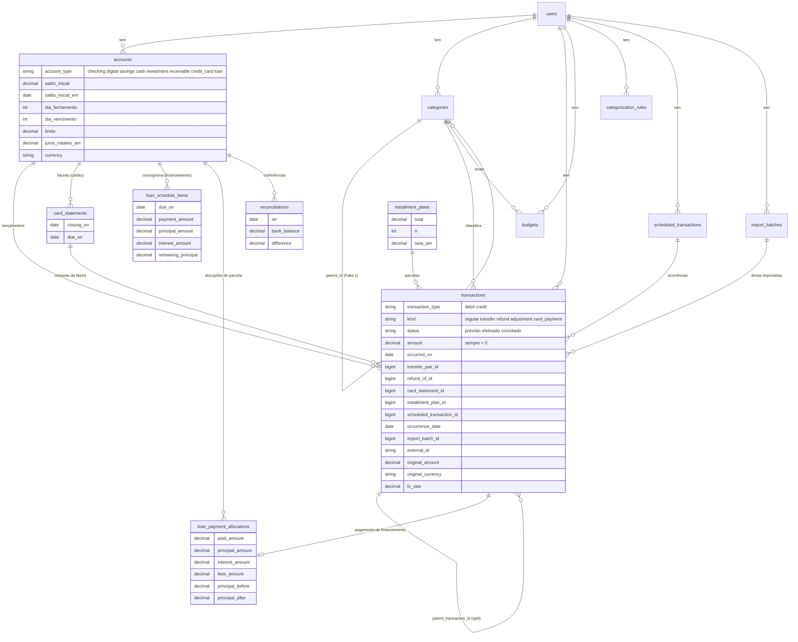

# 04 — Modelo de dados proposto

## Decisão: lançamento simples com pares, não partidas dobradas

| Critério | Partidas dobradas (ledger: `entries` + `postings`, Σ = 0) | Lançamento simples + par de transferência |
|---|---|---|
| Transferência | Natural: 1 lançamento, 2 postings | 2 linhas ligadas por `transfer_pair_id`, gravadas juntas |
| Cartão | Cartão é conta passivo; compra = débito despesa / crédito cartão | Cartão é conta passivo; mesma fórmula de saldo (spec 02) |
| Investimento | Exige contas de "custo", "ganho não realizado" | `investments` já é ledger de operações e fica como está |
| Categorias | Viram contas de resultado; orçamento e relatórios mudam de base | Ficam como estão |
| Migração | Reescreve **todas** as tabelas e **todos** os calculators e specs | Acrescenta colunas; calculators trocam o scope |
| Importação | Cada linha do PDF vira lançamento com 2 postings | Igual a hoje |
| Integridade | Σ = 0 garantido por construção | Par garantido por serviço transacional + constraint |
| Referências | GnuCash, Ledger, Beancount | ezBookkeeping (`RelatedId`), Actual (`transfer_id`). Sure e Cashew: não observados |

**Recomendação: lançamento simples com pares.** Os bugs reais do Klipper (R1–R6) vêm de **não saber o que é cada
linha** (pagamento, transferência, estorno), não de faltar partida dobrada. Os campos `kind` + `transfer_pair_id` +
`status` corrigem todos eles com mudança aditiva. O ledger completo custaria reescrever os 8 calculators e 53
arquivos de spec para um usuário único, sem bug que só ele resolva. A porta fica aberta: `kind` + par é exatamente o
que uma migração futura para postings precisaria.

## Diagrama



## Diferença em relação ao schema atual

| Tabela | Muda |
|---|---|
| `accounts` | + `saldo_inicial`, `saldo_inicial_em`, `dia_fechamento`, `dia_vencimento`, `limite`. Tipos `cash`, `receivable`, `loan`. `balance`, `saldo_fatura_atual`, `pagamento_minimo`, `iof_projetado` **deixam de ser lidos** (removidos numa migração posterior) |
| `transactions` | + `kind`, `status`, `transfer_pair_id`, `refund_of_id`, `card_statement_id`, `installment_plan_id`, `scheduled_transaction_id`, `occurrence_date`, `import_batch_id`, `external_id`, `original_amount`, `original_currency`, `fx_rate`. `dedupe_hash` → `external_id`. Valor `transfer` sai do enum |
| `categories` | Fatia 1 de UX (`parent_id`, `position`, `merged_into_id`) |
| `budgets` | + `rollover` |
| `net_worth_snapshots` | `(14,2)` → `(15,2)` |
| novas | `card_statements`, `installment_plans`, `loan_schedule_items`, `loan_payment_allocations`, `scheduled_transactions`, `import_batches`, `reconciliations`, `categorization_rules`, `iof_rates` |

## Plano de migrations (ordem segura)

Cada passo é aditivo, roda com o app de pé e tem migração de dados reversível.

| # | Migration | Dados existentes |
|---|---|---|
| M1 | `transactions.kind` (default `regular`, not null) e `status` (default `efetivado`, not null) | `transaction_type = 'transfer'` → `kind = 'transfer'`, `transaction_type` = `debit` |
| M2 | **Reclassificar pagamentos de fatura** (rake com `DRY_RUN=1`, como o backfill do FIN-002) | Linhas de conta cartão com descrição `^pagamento` → `kind: card_payment`, categoria nula. Relatório antes/depois de receita por mês |
| M3 | `transactions.external_id` + índice único parcial `(account_id, external_id)` | `external_id` = hash com ordinal (spec 06, I-1/I-3), recalculado com a conta atual; `dedupe_hash` mantido até M10 |
| M4 | `import_batches` + `transactions.import_batch_id` | Lotes antigos não existem: `null` (não podem ser desfeitos) |
| M5 | `accounts.saldo_inicial`, `saldo_inicial_em` | `saldo_inicial = 0`, `saldo_inicial_em` = data do primeiro lançamento da conta. O Roberto acerta pela primeira reconciliação (spec 02, C-10) |
| M6 | `transfer_pair_id`, `refund_of_id` | Vazio. Ferramenta de "ligar pares" sugere pares existentes (mesmo valor, ±3 dias, uma em cartão) |
| M7 | `reconciliations` | — |
| M8 | `accounts.dia_fechamento`, `dia_vencimento`, `limite`; `card_statements`; `transactions.card_statement_id` | Faturas criadas para as compras existentes do cartão pelo ciclo informado; compras importadas de PDF ficam na fatura do PDF |
| M9 | `installment_plans`, `transactions.installment_plan_id` | Agrupar linhas com mesma conta, descrição base e `installment_total`: plano retroativo, sem gerar previstas para o passado |
| M10 | Remover `dedupe_hash` e índice antigo; parar de expor `accounts.balance` | Só depois de um ciclo inteiro sem leitura (grep + teste) |
| M11 | `scheduled_transactions` + `occurrence_date` | — |
| M12 | `categorization_rules` (+ seed das 8 regex) | — |
| M13 | `budgets.rollover`, `iof_rates`, campos de moeda | — |

## Índices e restrições

```sql
-- integridade
CHECK (amount > 0)
CHECK (kind IN ('regular','transfer','refund','adjustment','card_payment'))
CHECK (status IN ('previsto','efetivado','conciliado'))
CHECK (kind NOT IN ('transfer','card_payment') OR category_id IS NULL)
CHECK (status = 'previsto' OR occurred_on <= CURRENT_DATE)    -- no model, não no banco (CURRENT_DATE é UTC no Neon)
FOREIGN KEY (transfer_pair_id) REFERENCES transactions ON DELETE RESTRICT
CHECK (dia_fechamento BETWEEN 1 AND 31), CHECK (dia_vencimento BETWEEN 1 AND 31)

-- unicidade
UNIQUE (account_id, external_id) WHERE external_id IS NOT NULL
UNIQUE (scheduled_transaction_id, occurrence_date) WHERE scheduled_transaction_id IS NOT NULL
UNIQUE (account_id, closing_on)                        -- card_statements
UNIQUE (transfer_pair_id) WHERE transfer_pair_id IS NOT NULL

-- consulta
(account_id, status, occurred_on) INCLUDE (amount, transaction_type)   -- saldo
(user_id, kind, occurred_on)                                           -- countable por mês
(card_statement_id)
```

O par de transferência é simétrico (A → B e B → A). O banco garante que cada linha tem no máximo um par; a simetria
é verificada no `TransferService` e por um spec de integridade que varre a tabela.

## Estratégia de saldos

| Opção | Custo | Risco |
|---|---|---|
| Cálculo sob demanda (`SUM` com índice) | 1 query por conta; ~10³–10⁴ linhas por conta para um usuário | Nenhum de consistência |
| Snapshot diário | Job diário (não roda local) e invalidação em edição retroativa | Saldo errado após editar o passado |
| Coluna materializada (`balance + delta`, ezBookkeeping) | Atualização em cada escrita, inclusive importação e desfazer | Deriva silenciosa; exige recálculo de auditoria |

**Recomendação: sob demanda**, com o índice de saldo acima. Para um usuário com dezenas de milhares de linhas, uma
`SUM` com índice de cobertura responde em milissegundos. A série histórica do detalhe de conta (Fatia 4 de UX) é uma
query só com `SUM(...) OVER (ORDER BY occurred_on)`. Snapshot fica apenas para o patrimônio mensal (já existe),
como cache recalculável. Revisar só se a medida (padrão `count_queries` / tempo, memória
`klipper-testes-de-performance`) mostrar problema.
